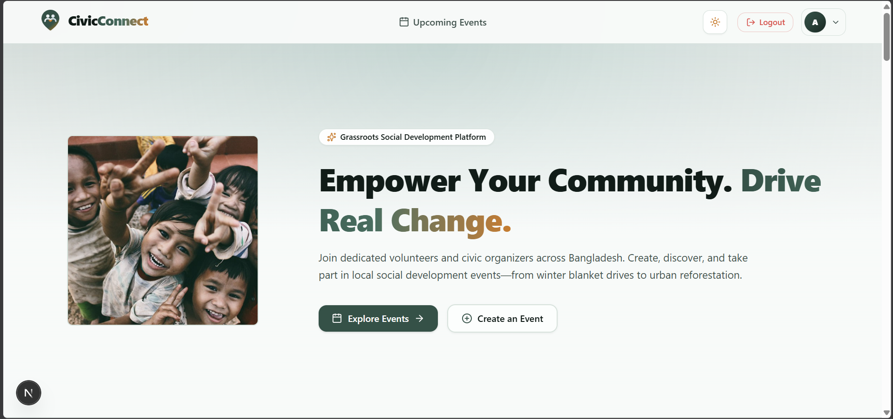

# CivicConnect - Community Social Development Platform

CivicConnect is a grassroots social development and volunteer coordination platform where citizens, students, and community organizers create, discover, and join local social development events across Bangladesh.

- **Live Client Web App**: [https://civicconnect-client.vercel.app](https://civicconnect-client.vercel.app)
- **Live Server REST API**: [https://civicconnect-server.vercel.app](https://civicconnect-server.vercel.app)

---

## Homepage Preview

<p align="center">
  
</p>

---

## Technologies Used

<p align="left">
  
</p>

### Frontend
- 
- 
- 
- 
- 
- 

### Backend & Security
- 
- 
- 
- 
- 

### Deployment & Tooling
- 
- 
- 

---

## Test Volunteer Account Credentials
For examiner evaluations and testing:
- **Email**: `volunteer@civicconnect.org`
- **Password**: `Volunteer123!`

---

## Key Feature Highlights
1. **Interactive Community Event Discovery**: Browse future-dated events filtered dynamically by category (Cleanup, Plantation, Donation, Food Drive, Health Camp, Winter Relief, Education, Charity) with instant title/location search.
2. **End-to-End Event Management**: Authenticated community leaders can organize new events with future date validation, edit event parameters in modal overlays, and delete events with cascading RSVP cleanup.
3. **One-Click Volunteer RSVP with Cancellation**: Community members can volunteer for any event, backed by unique compound indexes and real-time status toggles, with the ability to cancel attendance at any time via a dedicated confirmation modal.
4. **Secure Authentication with Better-Auth**: Robust session management featuring email/password sign-up (with optional photoURL and strict password strength requirements) and Google OAuth integration, issuing JWKS-verifiable JWTs to protected backend APIs.
5. **Modern Civic Theme with Dual Mode**: Rich forest pine green palette (`#275246`), warm amber accents, soft elevations, glassmorphism cards, micro-interactions, responsive navigation, and dark/light mode toggle with zero hydration flicker.
6. **Volunteer Profile Customization**: Users can view their volunteer credentials, member registration history, and update their display name and profile avatar dynamically.
7. **Our Impact Statistics & Partner Organizations**: Dynamic count-up community impact statistics and showcases with authentic emblems of Bangladeshi volunteer organizations.

---

## Environment Variables (`.env.local`)
```env
NEXT_PUBLIC_API_URL=http://localhost:8000
NEXT_PUBLIC_CLIENT_URL=http://localhost:3000
BETTER_AUTH_URL=http://localhost:3000
BETTER_AUTH_SECRET=9f8e4c7b2a1d6e3f5a0b9c8d7e6f4a3b
MONGODB_URI=mongodb+srv://<username>:<password>@cluster0.dp0xghu.mongodb.net/civicconnect_db?appName=Cluster0
GOOGLE_CLIENT_ID=<your-google-client-id>
GOOGLE_CLIENT_SECRET=<your-google-client-secret>
```

---

## Getting Started Locally

1. **Clone and install dependencies**:
   ```bash
   npm install
   ```

2. **Run the development server**:
   ```bash
   npm run dev
   ```

3. Open [http://localhost:3000](http://localhost:3000) in your browser.
